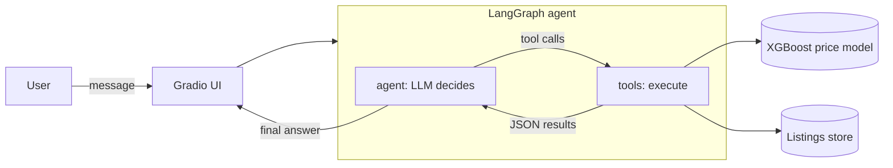

# Car Price Agent

An LLM agent that recommends prices for used cars and searches real listings.
It is built on top of an XGBoost price model trained in the Kaggle notebook
**car-price-prediction** (Craigslist Used Cars Dataset).

The agent understands requests in any language, calls tools that query the price model and
~150k real listings, and answers in the language of the question. The LLM never invents numbers:
every price, statistic and link in an answer comes from a tool result.



## Tools

| Tool | Purpose |
|---|---|
| `estimate_price` | price estimate with a calibrated 90% range, main factors and assumed values |
| `search_listings` | search listings by make, model, years, budget, mileage, state, body type, seller type |
| `find_comparables` | most similar real listings and their price statistics |
| `evaluate_listing` | asking price of a listing vs the model estimate |
| `list_known_values` | valid values of a field (models of a make, body types, states) |

## Project structure

```
car-price-agent/
├── artifacts/                  # model + listings exported from Kaggle (not versioned)
├── src/car_agent/
│   ├── config.py               # settings from environment / .env
│   ├── store.py                # loads the model and the listings
│   ├── tools.py                # tool implementations
│   ├── tool_schemas.py         # tool schemas as seen by the LLM
│   ├── prompts.py              # system instructions
│   ├── graph.py                # LangGraph agent
│   ├── app.py                  # Gradio chat UI
│   └── evaluation/             # evaluation cases, metrics and runner
└── tests/                      # unit tests (no LLM calls)
```

## Setup

Requirements: [uv](https://docs.astral.sh/uv/) (it installs Python 3.13 automatically).

```bash
uv sync
```

1. **Artifacts.** Run the Kaggle notebook, download the `car_price_model` folder from its output and
   put it into `artifacts/` (see [artifacts/README.md](artifacts/README.md)).
2. **API key.** Copy `.env.example` to `.env` and set `GROQ_API_KEY`
   (free tier: https://console.groq.com/keys).

## Usage

Chat UI (opens http://127.0.0.1:7860):

```bash
uv run car-agent-ui
```

Evaluation on the test cases (calls the LLM, takes a few minutes on the free tier):

```bash
uv run car-agent-eval
uv run car-agent-eval --limit 3          # quick check on the first 3 cases
```

Unit tests (no API key needed; tool tests are skipped if the artifacts are missing):

```bash
uv run pytest
```

## Evaluation

Each case in `src/car_agent/evaluation/cases.json` describes a conversation and what a correct agent
should do. The metrics are computed without an LLM judge, so they are cheap and reproducible:

| Metric | What it checks |
|---|---|
| `tool_recall` | the expected tools were called |
| `tool_precision` | no unexpected tools were called |
| `args_accuracy` | key arguments are right (e.g. `price_max=15000`, mileage converted from km) |
| `grounding` | every number in the answer appears in the tool results or in the user's message |
| `language_match` | the answer is in the language of the question |

Results are saved to `eval_results/` (JSON + Markdown summary), so runs can be compared after
changes to the prompt, the model or the tools.

## Limitations

- The data is a snapshot of U.S. Craigslist listings from April-May 2021 with asking prices,
  not transaction prices.
- Semantic search over listing descriptions is not implemented yet.
